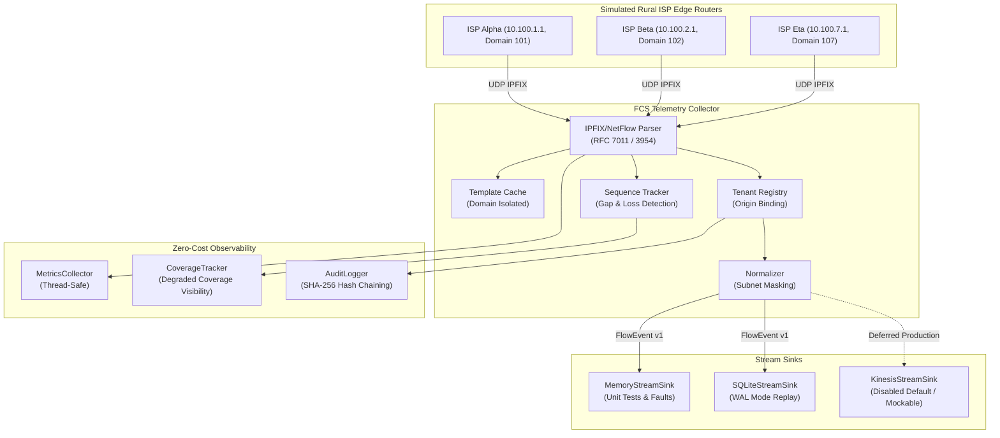

# Federated Cyber Shield (FCS) v1.2
## Phase 1 — Zero-Cost Cloud Foundation Implementation

[](#zero-cost-policy)
[](#automated-testing)
[](#infrastructure-as-code)
[](#development-setup)
[](LICENSE)

Federated Cyber Shield (FCS) is a cloud-oriented, privacy-preserving cybersecurity intelligence and threat-mitigation platform designed specifically for rural Internet Service Providers (ISPs). 

Phase 1 establishes the complete software and security foundation for FCS v1.2 at **₹0 / $0 cost**. It delivers:
- Multi-tenant isolation primitives and cryptographic audit logging for 7 simulated rural ISPs.
- Canonical telemetry contracts (`FlowEvent v1`) with deterministic event identification and subscriber IP privacy masking.
- Standards-compliant binary IPFIX (RFC 7011) and NetFlow v9 (RFC 3954) collector engine with domain-isolated template tracking.
- Observable sequence gap detection to expose dropped telemetry and prevent false "zero threat" assumptions.
- Pluggable streaming abstractions supporting in-memory buffers (`MemoryStreamSink`), durable local zero-cost persistence (`SQLiteStreamSink`), and an isolated future AWS adapter (`KinesisStreamSink`).
- Synthetic network traffic generator and replay framework supporting normal profiles and realistic fault scenarios.
- Complete OpenTofu Infrastructure-as-Code modules validated offline for future AWS deployment.

---

## Architecture Overview



---

## Free Development Setup

FCS Phase 1 requires no paid subscriptions, cloud credentials, or billable trials.

### Prerequisites
- Python 3.11, 3.12, or 3.13
- OpenTofu v1.6+ (or Terraform in read-only mode)
- Git 2.30+

### Setup Instructions
1. Clone the repository:
   ```bash
   git clone <repository-url>
   cd "industry 2"
   ```
2. Inspect environment variables:
   ```bash
   cp .env.example .env
   ```
3. Install dependencies:
   ```bash
   pip install -r requirements-dev.txt
   ```

---

## Running Verification & Tests

### One-Line Master Verification
Run the complete offline zero-cost verification suite (linter, strict type checker, 51 tests, OpenTofu validation, secret scan):
```bash
python scripts/verify_all.py
```

### Running Individual Test Suites
```bash
# Run all tests
python -m pytest tests/

# Run unit tests only
python -m pytest tests/unit/

# Run security & tenant isolation tests
python -m pytest tests/security/

# Run fault injection & resilience tests
python -m pytest tests/fault-injection/

# Run end-to-end synthetic ingestion integration tests
python -m pytest tests/integration/

# Run static OpenTofu policy tests
python -m pytest tests/infrastructure/
```

### Running Code Quality Tools
```bash
# Ruff linter
python -m ruff check .

# Mypy strict type checker
python -m mypy --explicit-package-bases packages services adapters tools tests

# OpenTofu format check
tofu fmt -check -recursive infrastructure/opentofu/

# OpenTofu static validation (offline definition mode)
cd infrastructure/opentofu/environments/dev
tofu validate
```

---

## Multi-Tenant Security Constraints

- **Strict Tenant Boundaries**: Cross-tenant data access is unconditionally denied. A tenant cannot view or query telemetry belonging to another ISP.
- **Untrusted Metadata Rejection**: Claims embedded inside telemetry packets (e.g. vendor fields claiming a tenant ID) that conflict with the authenticated exporter registration are dropped (`UntrustedTenantClaimViolation`).
- **Platform Admin Restrictions**: Platform administrators cannot view raw tenant telemetry. Administrative access is restricted to tenancy lifecycle and aggregate platform health metrics.
- **Subscriber Privacy Preservation**: Host subscriber IP addresses are masked to `/24` (IPv4) or `/48` (IPv6) network prefixes. Raw host IP addresses are never persisted.
- **Degraded Coverage Visibility**: Missing telemetry is explicitly tracked and displayed as `DEGRADED` or `DEAD` coverage. The system warns that absence of telemetry must **never** be interpreted as absence of threats.

---

## Zero-Cost Policy & Three-Tier Execution Model

FCS Phase 1 enforces an absolute ₹0 budget:

| Execution Level | Description | Implementation Status |
|---|---|---|
| **Level A: Workspace Verification** | Offline development, testing, parsing, and simulation using free open-source tools. | **100% Implemented & Passing** |
| **Level B: Free Hosted CI** | Ephemeral GitHub Actions standard runners running short-lived test jobs with minimal permissions. | **Workflows Implemented** |
| **Level C: Production Deployment** | Real AWS cloud provisioning (NLB, Kinesis, KMS, S3, ECS). | **BLOCKED_BY_ZERO_COST_POLICY** (Deferred to future funded phase) |

---

## Documentation Index

- [Phase 1 Architecture Specification](file:///c:/college/industry%202/docs/architecture/phase1.md)
- [Security Threat Model](file:///c:/college/industry%202/docs/security/threat-model.md)
- [Zero-Cost Compliance Report](file:///c:/college/industry%202/docs/phase-reports/zero-cost-compliance.md)
- [Phase 1 Verification Report](file:///c:/college/industry%202/docs/phase-reports/phase1-verification.md)
- [Future AWS Deployment Procedure (Deferred)](file:///c:/college/industry%202/docs/deployment/future-aws-deployment.md)
- [Telemetry Operations Runbook](file:///c:/college/industry%202/docs/operations/telemetry-runbook.md)
- [Architecture Decision Records (ADRs)](file:///c:/college/industry%202/docs/decisions/)
- [Phase 1 Completion Report](file:///c:/college/industry%202/PHASE1_COMPLETION_REPORT.md)

---

## License
Apache License 2.0. Copyright (c) 2026 Federated Cyber Shield Architecture Team.
