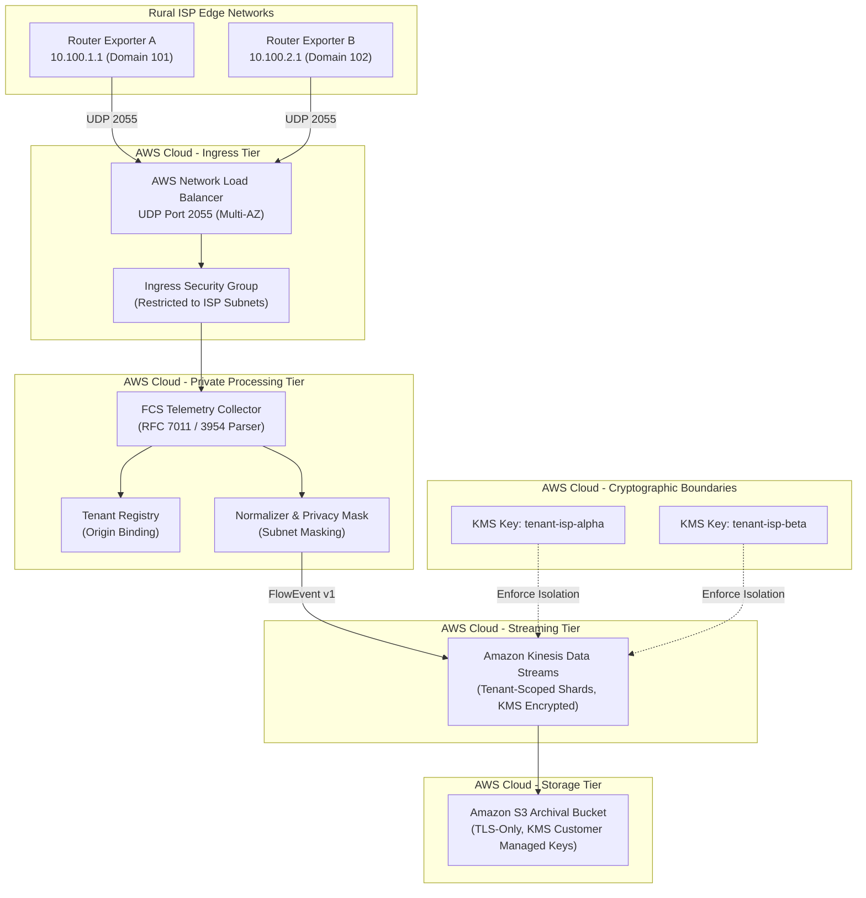
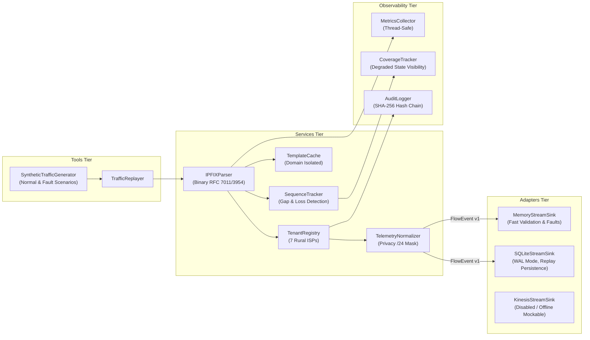

# Federated Cyber Shield (FCS) v1.2 — Architecture Specification (Phase 1)

## 1. System Overview
Federated Cyber Shield (FCS) is a cloud-oriented, privacy-preserving cybersecurity telemetry platform purpose-built for rural Internet Service Providers (ISPs). Phase 1 delivers the foundational data contracts, multi-tenant isolation primitives, IPFIX/NetFlow v9 collector, synthetic traffic generator, streaming abstraction, and static infrastructure definitions.

---

## 2. Future Production AWS Architecture
The planned production architecture is defined via modular OpenTofu IaC modules. The deployment operates in **definition-only mode** during Phase 1 to guarantee ₹0 expenditure.

---

## 3. Phase 1 Free Simulation Architecture (Level A)
To eliminate cloud costs entirely, Phase 1 simulates the entire ingestion and streaming lifecycle in the workspace using open-source, thread-safe components:

---

## 4. Trust Boundaries & Tenant Isolation
1. **Physical Exporter Resolution**: Incoming packets are mapped to a tenant via authenticated exporter IP and Observation Domain ID.
2. **Untrusted Metadata Rejection**: Claims embedded inside telemetry packets that contradict trusted configuration raise `UntrustedTenantClaimViolation` and are dropped.
3. **RBAC Isolation**:
   - `TENANT_ADMIN` & `TENANT_ANALYST`: Scoped exclusively to their own tenant ID.
   - `PLATFORM_ADMIN`: Manages tenancy metadata and platform health. Strictly prohibited from reading raw telemetry records.
4. **Subscriber Privacy**: IP addresses are masked to `/24` network prefixes. Raw host subscriber identifiers are never stored.

---

## 5. Separation of Implementations vs Cloud Deployments
| Layer | Implemented in Phase 1 | Status | Real Cloud Deployment |
|---|---|---|---|
| **Data Contracts** | Pydantic FlowEvent v1, JSON canonical, hash | Complete & Tested | N/A (Portable) |
| **Collector Parser** | Binary IPFIX & NetFlow v9 parser, template cache | Complete & Tested | Runs on dev/test compute |
| **Stream Adapter** | MemoryStreamSink & SQLiteStreamSink | Complete & Tested | Ephemeral & local persistence |
| **AWS Kinesis Adapter** | Isolated adapter, partition key scoping, mockable | Complete (Disabled) | `BLOCKED_BY_ZERO_COST_POLICY` |
| **OpenTofu Modules** | 8 reusable modules (networking, IAM, S3, KMS, etc.) | Formatted & Validated | `BLOCKED_BY_ZERO_COST_POLICY` |
| **AWS Accounts & IAM** | Policy logic & least-privilege definitions | Statically Verified | `BLOCKED_BY_ZERO_COST_POLICY` |
