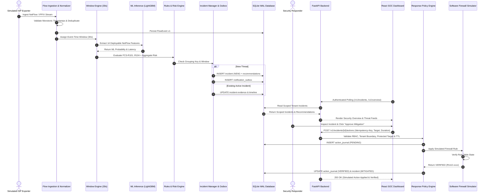

# Federated Cyber Shield (FCS) v1.2 — Phase 4 Architecture Specification
## Real-Time Threat Detection, Security Operations Dashboard & Manual Response System

**Status:** IMPLEMENTED & VERIFIED  
**Architecture Baseline:** Federated Cyber Shield v1.2  
**Implementation Budget:** Strictly ₹0 / $0 (Local CPU & SQLite Development Engine)  
**Execution Environment:** Antigravity / Free Open-Source Python & React/TypeScript Toolchain  

---

## 1. Executive Architecture Overview

Federated Cyber Shield (FCS) Phase 4 delivers the first complete, operationally testable cybersecurity Minimum Viable Product (MVP). It bridges the telemetry ingestion and stream adapters of Phase 1, the unified dataset and feature schemas of Phase 2, and the validated machine learning candidate models of Phase 3 into a cohesive, human-in-the-loop security operations workflow.

```text
         SIMULATED / AUTHORIZED ISP TELEMETRY
                         |
                         v
                 IPFIX / NETFLOW COLLECTOR
                         |
                         v
                  INPUT VALIDATION
                         |
                         v
                DURABLE EVENT ADAPTER
                         |
                         v
                FEATURE WINDOW ENGINE (30s event-time, 60s lateness)
                         |
                         v
               VERIFIED ML INFERENCE (LightGBM Deployable Subset, 14 NetFlow features)
                         |
                         v
               THREAT DETECTION RULES (FCS-R101..R104)
                         |
                         v
                  RISK ASSESSMENT (Composite Risk Scoring & Classification)
                         |
                         v
                   INCIDENT ENGINE (Grouping, Deduplication, Lifecycle)
                         |
              +----------+----------+
              |                     |
              v                     v
       INCIDENT DATABASE      NOTIFICATION OUTBOX
              |                     |
              +----------+----------+
                         |
                         v
                FASTAPI BACKEND (/v1/* REST API with RBAC & Tenant Scoping)
                         |
                         v
              REACT SECURITY DASHBOARD (7 SOC Views, Live Polling)
                         |
                         v
              ACTION RECOMMENDATIONS (Temporary Block, Rate Limit, Deep Inspection)
                         |
                         v
             HUMAN ADMINISTRATOR APPROVAL (SECURITY_RESPONDER / TENANT_ADMIN)
                         |
                         v
                RESPONSE POLICY ENGINE (Protected IP Guardrails, TTL Constraints)
                         |
                         v
                FIREWALL SIMULATOR (Isolated Software Engine, Rule Verification)
                         |
                         v
              VERIFY + AUDIT + UPDATE (Rollback Capability, Incident MITIGATED)
```

---

## 2. Core Subsystems

### 2.1 Ingestion & Normalization Engine
- **Telemetry Ingestion:** Receives NetFlow v5/v9 and IPFIX records from authorized ISP exporters (`rural-isp-alpha` through `rural-isp-golf`).
- **Validation & Parsing:** Flow records are parsed and mapped into immutable [FlowEvent](file:///c:/college/industry%202/packages/contracts/flow.py) v1 contracts. Timestamps are verified for monotonicity, sequence numbers are tracked for gap detection, and malformed records are rejected with audit logging.
- **Durable Persistence:** In development mode, flows are committed to SQLite with WAL (Write-Ahead Logging) mode and foreign-key enforcement, maintaining full interface compatibility with future AWS Kinesis adapters.

### 2.2 Feature Window Engine
- **Event-Time Partitioning:** Grouped by `tenant_id` with 30-second deterministic event-time tumbling windows.
- **Lateness Tolerance:** Accommodates out-of-order flows up to 60 seconds late. Events arriving within the lateness window update window aggregate statistics without generating duplicate incidents. Events beyond allowed lateness are discarded with metric recording.
- **Idempotency & Checkpointing:** Checkpoints are persisted in `feature_windows` table with deterministic hashes:
  $$\text{window\_id} = \text{sha256}(\text{tenant\_id} \mathbin{\Vert} \text{window\_start\_utc} \mathbin{\Vert} \text{window\_end\_utc})$$

### 2.3 ML Inference & Feature Contract Parity
- **Candidate Model:** Phase 3's benchmark-selected [lightgbm_deployable_subset](file:///c:/college/industry%202/services/ml_training/src/fcs_ml/registry/registry.py) is warm-loaded at backend startup.
- **Feature Parity:** Evaluates the locked 14-feature `deployable_v1` schema extracted directly from NetFlow headers (byte counts, packet counts, protocol, TCP flags, duration, rates, and IP entropy).
- **Zero Network Action Invariant:** ML inference outputs pure probabilistic risk scores. All scoring envelopes enforce `network_action_executed = False`. Under no circumstances can an ML model directly invoke firewall execution.

### 2.4 Hybrid Detection & Threat Scoring
- **Deterministic Defensive Rules:**
  - `FCS-R101`: Volumetric Flood / DDoS Burst ($\text{bytes} > 500{,}000$ or $\text{pkts} > 2{,}500$ or $\text{flow\_count} > 80$) $\rightarrow$ CRITICAL / HIGH.
  - `FCS-R102`: SYN Port Scanning / Reconnaissance ($\text{tcp\_flags} = 2$ and $\text{pkts} < 10$) $\rightarrow$ MEDIUM.
  - `FCS-R103`: Slowloris / Abnormal Duration ($\text{duration} > 60\text{s}$ and $\text{bytes} < 5{,}000$) $\rightarrow$ LOW.
  - `FCS-R104`: Critical Infrastructure Port Probe ($\text{dst\_port} \in \{23, 2323, 445, 3389, 5060\}$) $\rightarrow$ MEDIUM.
- **Risk Aggregation:** Combines ML calibrated probability ($P_{\text{threat}}$) and matched rule severities into an explainable 0–100 risk score and classification (`INFORMATIONAL`, `LOW`, `MEDIUM`, `HIGH`, `CRITICAL`).

### 2.5 Incident Management & Deduplication
- **Deduplication Key:** Computes deterministic grouping keys:
  $$\text{grouping\_key} = \text{sha256}(\text{tenant\_id} \mathbin{\Vert} \text{attack\_category} \mathbin{\Vert} \text{primary\_target\_ip})$$
- **Suppression Interval:** Multiple alerts within a 300-second window are aggregated into the existing active incident, appending fresh flow evidence references rather than flooding the analyst queue.
- **Lifecycle Machine:** Validated transitions:
  $$\text{NEW} \longrightarrow \text{ACKNOWLEDGED} \longrightarrow \text{INVESTIGATING} \longrightarrow \text{ACTION\_PENDING} \longrightarrow \text{MITIGATED} \longrightarrow \text{RESOLVED} \mid \text{FALSE\_POSITIVE} \mid \text{CLOSED}$$

### 2.6 Manual Response Policy & Isolation Engine
- **Response Mode:** Strictly `MANUAL`. Autonomous mode (`AUTO`) is explicitly disabled in backend code and configuration.
- **Mandatory Human Approval:** Defensive actions must be authorized by an authenticated user with `SECURITY_RESPONDER` or `TENANT_ADMIN` role.
- **Safety Policy & Guardrails:**
  - Protected Management Targets: Requests targeting `10.0.0.1`, `10.0.0.2`, `192.168.1.1`, `127.0.0.1`, or `1.1.1.1` are rejected with `400 Bad Request`.
  - Max Duration TTL: Action durations are strictly clamped between 60 seconds (1 minute) and 86,400 seconds (24 hours).
  - Cross-Tenant Action Rejection: Action execution attempts across tenant boundaries fail with `403 Forbidden`.
  - Idempotency Conflict Detection: Submitting the same idempotency key with conflicting parameters fails immediately.
- **Isolated Software Firewall Simulator:**
  - Manages simulated firewall state in `simulated_firewall_rules` table.
  - Generates verifiable rule entries: `RULE-<hash>`, status `ACTIVE`, with expiration timestamps.
  - Supports instant manual rollback and automated TTL expiry verification.
  - Outputs explicit safety disclaimer: *"Simulated defensive action — no real network device modified."*

---

## 3. Data Flow Diagram



---

## 4. Component Directory Structure

```text
c:\college\industry 2\
├── apps/
│   └── security-dashboard/          # React 18 / TypeScript / Vite / Tailwind SOC UI
│       ├── src/
│       │   ├── components/          # Reusable MetricCard, StatusBadge, Sidebar, Header
│       │   ├── pages/               # 7 SOC Pages (Overview, Threat, Incidents, Actions, Health, Model, Settings)
│       │   ├── services/            # Typed API Client with JWT Bearer auth
│       │   ├── types/               # TypeScript interfaces matching backend models
│       │   └── index.css            # Dark cybersecurity SOC theme with glowing badges
│       ├── dist/                    # Compiled static production bundle
│       └── package.json             # Pinned frontend dependencies
│
├── services/
│   └── api/src/fcs_api/             # Modular FastAPI Monolith
│       ├── auth/                    # PBKDF2 hashing, JWT tokens, RBAC dependencies
│       ├── database.py              # SQLite connection, schema DDL, demo seeders
│       ├── detection/               # LightGBM warm-loader, rules FCS-R101..104, risk scoring
│       ├── firewall/                # Isolated software firewall simulator & rule tables
│       ├── incidents/               # Deduplication, state machine, outbox
│       ├── response/                # Response Policy Engine, guardrails, rollback
│       ├── routes/                  # Modular routers (auth, overview, incidents, actions, detection, dev)
│       ├── telemetry/               # WindowEngine (30s event-time), replay coordinator
│       └── app.py                   # FastAPI application factory & static dist mount
│
├── tools/
│   └── fcs_cli.py                   # Unified CLI tool (`fcs api start`, `fcs demo replay`, etc.)
│
├── tests/
│   ├── phase4-unit/                 # Unit tests (auth, window engine, detection rules, firewall)
│   ├── phase4-integration/          # Integration tests (E2E pipeline, replay scenarios, API)
│   └── phase4-security/             # Security tests (tenant isolation, RBAC, policy safety, AUTO disabled)
│
├── scripts/
│   └── verify_phase4.py             # Phase 4 zero-cost verification & release gates script
│
├── phase4_status.json               # Automated machine-readable verification evidence
└── PHASE4_COMPLETION_REPORT.md      # Comprehensive executive completion report
```
