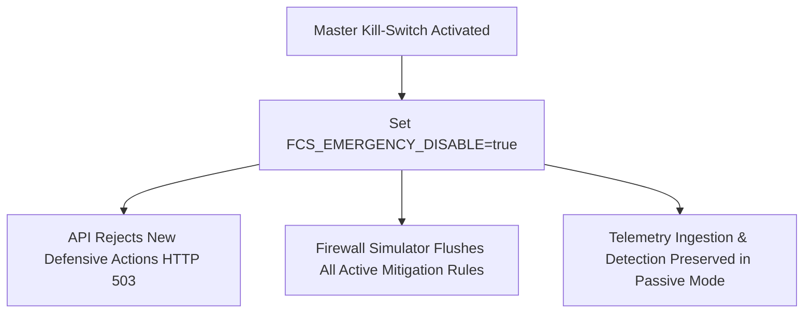

# Federated Cyber Shield (FCS) v1.2 — Master Emergency Disable Protocol

## 1. Emergency Kill-Switch Architecture

In carrier telecommunications networks, operators must possess the capability to halt all defensive actions instantly in the event of an operational anomaly.

FCS implements a multi-layer **Master Emergency Disable** kill-switch:



---

## 2. Emergency Trigger Procedures

### 2.1 Environment / CLI Kill-Switch
To execute an immediate cluster-wide kill-switch:

```bash
export FCS_AUTO_RESPONSE_ENABLED="false"
export FCS_EMERGENCY_DISABLE="true"
```

### 2.2 Invariant Guarantees During Emergency Disable
- **Simulator Flush**: All active simulated rate-limits or blackhole rules are purged immediately.
- **Passive Monitoring Unaffected**: Flow window collection, feature extraction, and ML scoring continue uninterrupted to record forensic data.
- **Fail-Safe Default**: If communication between components is severed, the system defaults to safe passive monitoring.
