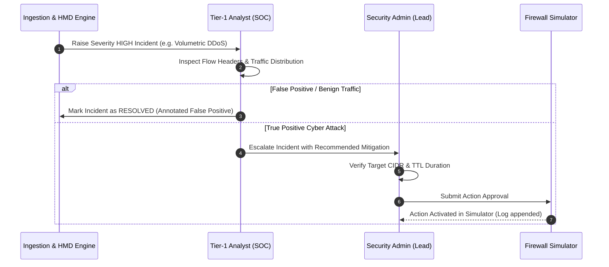

# Federated Cyber Shield (FCS) v1.2 — Incident Escalation & Response Protocol

## 1. Role-Based Escalation Matrix

FCS defines strict separation of duties for security analysts and engineers:

| Role Identifier | Assigned Personnel | Permissions & Capabilities | Defensive Mitigation Authority |
|---|---|---|---|
| **TIER_1_ANALYST** | SOC Analyst / Watch Officer | Read alerts, review flow traces, query history, draft mitigation notes | **CANNOT APPROVE** actions |
| **SECURITY_ADMIN** | Lead SOC Engineer / Incident Commander | Full administrative access, modify tenant policy, trigger backups | **AUTHORIZED** to approve actions |
| **SYSTEM_OPERATOR** | Platform / Infrastructure SRE | Service restarts, database backups, log maintenance | **READ-ONLY** on tenant telemetry |

---

## 2. Escalation Workflow Diagram

---

## 3. High-Priority Threat Scenarios

- **DDoS Volumetric Floods**: Automatically prioritized as `CRITICAL`. Immediate recommendation: Rate-limit or blackhole attacking source prefix.
- **Port Scan / Reconnaissance**: Prioritized as `MEDIUM`. Recommendation: Drop scan packets for 1800s.
- **Cross-Tenant Breach Attempt**: System-level `SECURITY_AUDIT` alert dispatched immediately to all tenant administrators.
