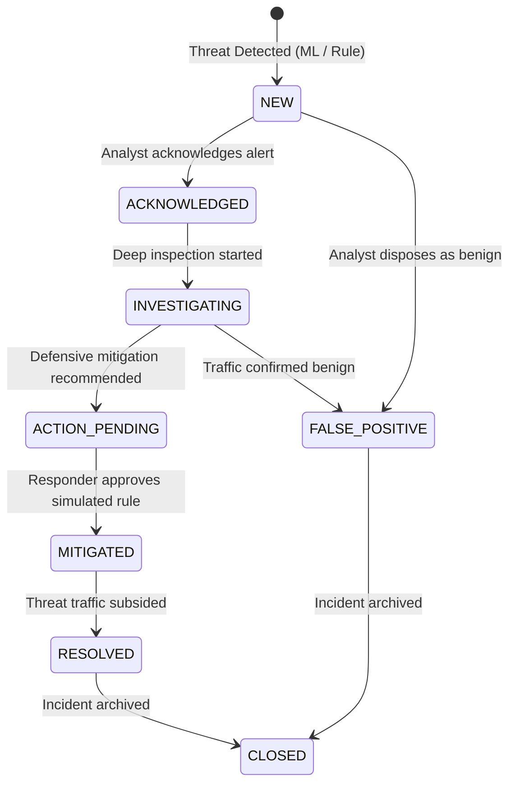

# Federated Cyber Shield (FCS) v1.2 — Incident Management Operations Guide
## Incident Lifecycle, Deduplication, Forensic Evidence & Transactional Outbox

**Status:** OPERATIONAL & TESTED (Gate G03 & G07: PASS)  
**Persistence Engine:** SQLite Development WAL Database with Transactional Integrity  

---

## 1. Incident Lifecycle State Machine

Every detected security anomaly in Federated Cyber Shield progresses through a strictly validated state transition lifecycle:



### Validated State Transitions Table

| From Status | Permitted Target Statuses | Required Role |
| :--- | :--- | :--- |
| `NEW` | `ACKNOWLEDGED`, `INVESTIGATING`, `FALSE_POSITIVE` | `SECURITY_ANALYST`, `SECURITY_RESPONDER`, `TENANT_ADMIN` |
| `ACKNOWLEDGED` | `INVESTIGATING`, `ACTION_PENDING`, `FALSE_POSITIVE` | `SECURITY_ANALYST`, `SECURITY_RESPONDER`, `TENANT_ADMIN` |
| `INVESTIGATING` | `ACTION_PENDING`, `MITIGATED`, `RESOLVED`, `FALSE_POSITIVE` | `SECURITY_ANALYST`, `SECURITY_RESPONDER`, `TENANT_ADMIN` |
| `ACTION_PENDING`| `MITIGATED`, `INVESTIGATING`, `FALSE_POSITIVE` | `SECURITY_RESPONDER`, `TENANT_ADMIN` |
| `MITIGATED` | `RESOLVED`, `INVESTIGATING`, `CLOSED` | `SECURITY_ANALYST`, `SECURITY_RESPONDER`, `TENANT_ADMIN` |
| `RESOLVED` | `CLOSED`, `INVESTIGATING` | `SECURITY_ANALYST`, `TENANT_ADMIN` |
| `FALSE_POSITIVE`| `CLOSED`, `INVESTIGATING` | `SECURITY_ANALYST`, `TENANT_ADMIN` |

---

## 2. Alert Grouping & Deduplication Engine

In high-throughput ISP environments, active denial-of-service or port scanning traffic can generate thousands of anomalous flows per minute. To prevent analyst alert fatigue, FCS implements deterministic deduplication:

1. **Grouping Key Calculation:**
   $$\text{grouping\_key} = \text{sha256}(\text{tenant\_id} \mathbin{\Vert} \text{attack\_category} \mathbin{\Vert} \text{primary\_target\_ip})$$
2. **Suppression Interval:**
   - Active grouping window: 300 seconds (5 minutes).
   - If an open incident matching the `grouping_key` exists within the suppression interval, the engine does not create a new incident.
   - Instead, it appends the new flow records to `incident_evidence`, refreshes the detection score, and updates `updated_at_utc`.
3. **Audit Trail Recording:**
   - Every status modification is recorded in `incident_history` with `actor_id`, timestamp, previous status, new status, and analyst notes.

---

## 3. Transactional Notification Outbox

To guarantee reliable delivery of incident alerts without distributed two-phase commits:

1. When a new incident is created, an event record is written transactionally into `notification_outbox`:
   ```sql
   INSERT INTO notification_outbox (outbox_id, tenant_id, incident_id, event_type, payload, status, created_at_utc)
   VALUES (:id, :tenant_id, :incident_id, 'INCIDENT_CREATED', :payload, 'PENDING', :now);
   ```
2. The asynchronous background worker processes pending outbox rows, delivering notifications to configured webhook destinations or dashboard SSE channels.
3. Upon verified delivery, the row is marked `DELIVERED`. If delivery fails, it is marked `FAILED` and scheduled for exponential backoff retries.

---

## 4. Operational API Reference

- `GET /v1/incidents?status=NEW&severity=CRITICAL`: Query incidents with filtering and pagination.
- `GET /v1/incidents/{incident_id}`: Retrieve detailed incident context including raw flow metrics and ML probabilities.
- `PATCH /v1/incidents/{incident_id}`: Update lifecycle status with mandatory analyst disposition notes.
- `GET /v1/incidents/{incident_id}/history`: Retrieve complete forensic audit timeline.
- `GET /v1/incidents/{incident_id}/recommendations`: Retrieve actionable defensive recommendations generated for this threat.
