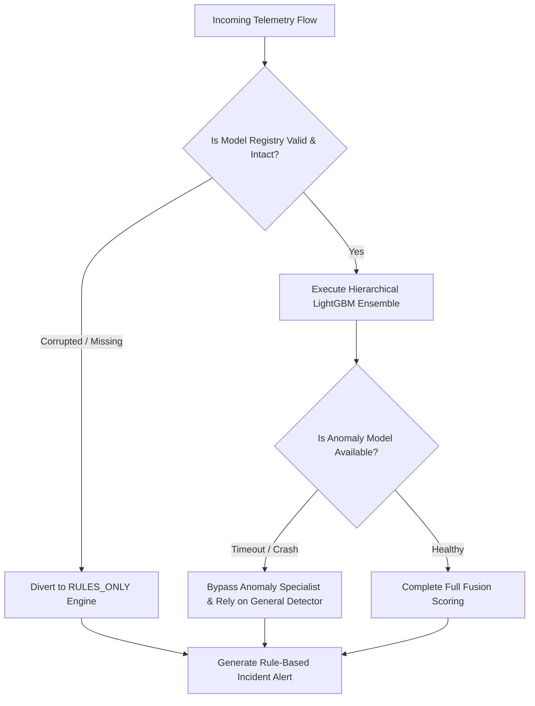

# Federated Cyber Shield (FCS) v1.2 — Failure Modes & Graceful Degradation

## 1. System Failure Matrix & Automated Degradation

FCS is engineered for high resilience across partial system outages without operator intervention:

---

## 2. Tested Degradation Scenarios

1. **Model Weights Corrupted or Missing**:
   - `DetectionService` catches the exception on startup or inference.
   - Activates fallback engine (`fallback_mode = "RULES_ONLY"`).
   - Rules `FCS-R101` (DDoS volumetric spike), `FCS-R102` (SYN flood), `FCS-R103` (Port scan recon), and `FCS-R104` (Abnormal packet ratio) continue evaluating without dropping telemetry.
2. **Federation Coordinator Network Loss**:
   - Federated learning runs out-of-band on a periodic cadence.
   - If the Flower server is unreachable, local nodes log a retry warning and continue scoring network traffic using the active validated local model.
3. **Database Write Lock Contention**:
   - Handled via SQLite WAL concurrency mode and exponential backoff retry in the API persistence layer.
