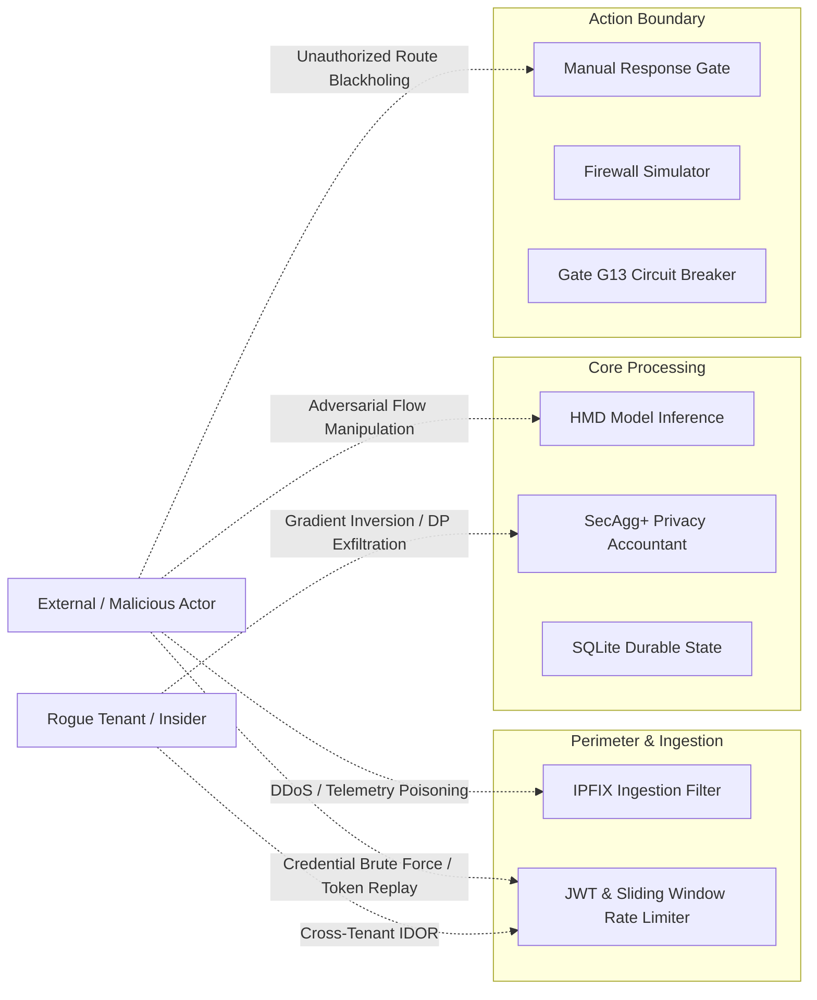

# Federated Cyber Shield (FCS) v1.2 — Final Security Threat Model

## 1. Threat Modeling Scope & Methodology

This threat model synthesizes the security properties of FCS Architecture v1.2, evaluated according to the STRIDE framework and zero-trust telecommunications defense standards.

---

## 2. STRIDE Assessment Matrix

| Threat Category | Primary Attack Vector | FCS Defense & Mitigating Controls | Residual Risk Level |
|---|---|---|---|
| **Spoofing** | Forged exporter IP addresses; forged tenant credentials in API headers | Source IP binding, exporter registry verification, HMAC signature checks, JWT cryptographic signature verification | LOW |
| **Tampering** | Model artifact poisoning; SQLite transaction alteration | Dual ECDSA P-256 + ML-DSA-65 manifest signing, SQLite WAL checksumming, append-only cryptographic audit ledger | NEGLIGIBLE |
| **Repudiation** | Denying issuance of defensive mitigation commands | Cryptographic audit trail linking tenant ID, user sub, action ID, timestamp, and target IP | NEGLIGIBLE |
| **Information Disclosure** | Cross-tenant telemetry exfiltration; gradient inversion in federated training | Strict tenant query filtering at ORM layer, SecAgg+ masked vector aggregation, Opacus DP-SGD ($\epsilon < 3.0, \delta < 10^{-5}$) | LOW |
| **Denial of Service** | Volumetric IPFIX stream saturation; API brute-force | Zero-allocation streaming parser, sliding-window authentication rate limiter (5 attempts / 60s), CPU-bounded LightGBM scoring | LOW |
| **Elevation of Privilege** | Tier-1 Analyst attempting to trigger defensive mitigation | Strict role-based access control (RBAC); only `SECURITY_ADMIN` role authorized to approve actions | NEGLIGIBLE |

---

## 3. Post-Quantum & Cryptographic Hardening

- **Post-Quantum Algorithm**: NIST FIPS 204 ML-DSA-65 (Module-Lattice-Based Digital Signature Standard).
- **Dual Verification Model**: Every release manifest and consortium model weight package is signed with both conventional ECDSA P-256 and post-quantum ML-DSA-65.
- **Fail-Safe Revocation**: If either signature verification fails, the model is rejected and the system falls back to `RULES_ONLY` mode.
