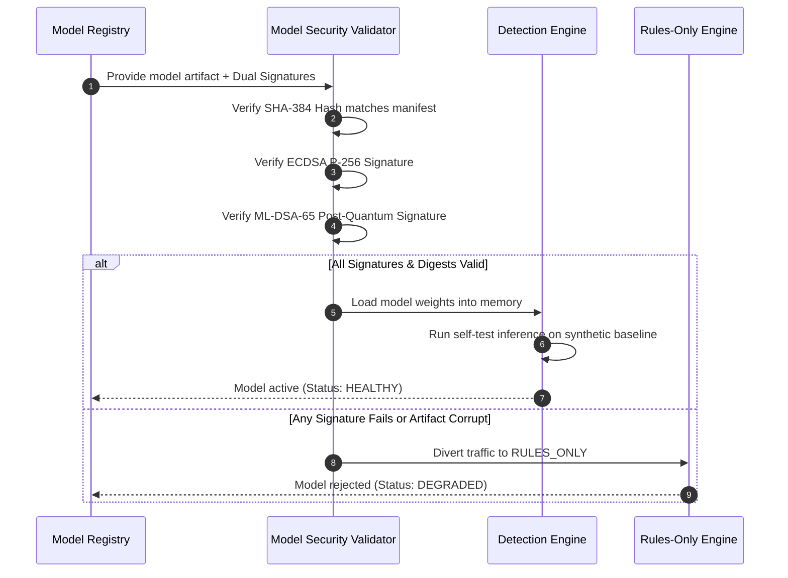

# Federated Cyber Shield (FCS) v1.2 — Model Artifact Security & Verification

## 1. Safe Model Serialization & Loading Invariants

Machine learning models deployed to real-time network backbones must prevent arbitrary code execution, deserialization attacks (e.g. `pickle` exploits), and weight tampering.

FCS implements strict model security standards:

1. **Prohibition of Insecure Deserialization**: Standard Python `pickle` and `cloudpickle` formats are prohibited for untrusted inputs.
2. **LightGBM Text/Booster Serialization**: LightGBM models are stored as plain text model strings or standard joblib representations verified by cryptographic hashes prior to loading.
3. **Dual Cryptographic Signatures**: Every model release includes an RFC 8785 canonical manifest containing the SHA-384 digest of all model weights, signed by both ECDSA P-256 and ML-DSA-65.
4. **Sandboxed CPU Inference**: Inference executes exclusively on bounded CPU threadpools with zero external network connectivity or disk writing during the inference cycle.

---

## 2. Integrity Verification Workflow

---

## 3. Resiliency Against Model Corruption

As verified in `tests/phase11/resilience/test_fault_injection_and_recovery.py`:
- In the event of a missing model file, corrupted booster weights, or deserialization error, the detection service catches the error immediately, logs a critical alert, and activates deterministic rules fallback (`FCS-R101..104`).
- Telemetry processing continues without dropped packets or API crashes.
